This project is part of the **Spatial Transcriptomics** (ST-omics) initiative supported by the **Cancéropôle Provence-Alpes-Côte d’Azur**.

Spatial transcriptomics (ST) encompasses a range of technologies that enable gene expression to be studied directly within the **spatial context** of the original tissue. By preserving the **spatial organization** of cells and their **surrounding environment**, these approaches provide complementary information to single-cell transcriptomics and are particularly valuable for studying tumor heterogeneity and cellular interactions within the tumor microenvironment.

The ST-omics initiative aims to support the deployment of spatial transcriptomics technologies, bring together expertise in histogenomics and computational biology, and provide training and analytical solutions to facilitate the adoption of these technologies by the cancer research community.

More information about the ST-omics initiative: [Cancéropôle Provence-Alpes-Côte d’Azur](https://canceropole-paca.com/propulser-vos-recherches/acceder-aux-technologies-expertises/st-omics-laction-structurante-dediee-a-la-transcriptomique-spatiale/)

In this context, we present an analysis workflow for Xenium spatial transcriptomics data, with a particular focus on **tissue microarrays (TMAs)**. The workflow covers the main steps involved in Xenium data analysis, from preprocessing and quality control to neighborhood analysis.

The code provided in this repository is organized according to the structure outlined in the diagram below. Each step of the workflow is briefly described in the following sections. More detailed information about each step can be found in the corresponding README file within each code section of the repository.

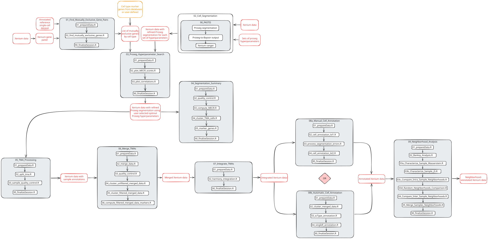

# **Table of contents**

- [Example data and analysis reports](#example-data-and-analysis-reports)
- [Find mutually exclusive gene pairs](#find-mutually-exclusive-gene-pairs)
- [Cell segmentation](#cell-segmentation)
- [Proseg hyperparameter search](#proseg-hyperparameter-search)
- [Segmentation summary](#segmentation-summary)
- [TMA processing](#tma-processing)
- [Merge TMAs](#merge-tmas)
- [Integrate TMAs](#integrate-tmas)
- [Manual cell annotation](#manual-cell-annotation)
- [Automatic cell annotation](#automatic-cell-annotation)
- [Neighborhood analysis](#neighborhood-analysis)

# **Example data and analysis reports**

The example data used to illustrate the Xenium analysis workflow, along with the corresponding HTML analysis reports and singularity images, are available for download at the following link:

[https://doi.org/10.5281/zenodo.23082667]

# **Find mutually exclusive gene pairs**

**Mutually Exclusive Co-expression Rate (MECR)** is a metric that can be used to assess the quality of cell segmentation in imaging spatial transcriptomics data.

MECR is computed by dividing the fraction of cells that express both markers by the fraction of cells that express at least one of the markers, for each pair of preselected mutually exclusive genes ([Satija et al., bioRxiv, 2024](https://www.biorxiv.org/content/10.1101/2024.01.11.575135v1.full)).

Computing this metric requires access to a list of mutually exclusive gene pairs adapted to the dataset being analyzed. These correspond to **genes that are not expected to be co-expressed within the same cell type** (i.e., genes whose expression is typically restricted to distinct cell types).

The aim of this analysis step is therefore to retrieve a list of mutually exclusive gene pairs from a reference single-cell dataset. The cell types present in this reference are expected to also be represented in the spatial dataset. The gene pairs identified in this analysis will be used in subsequent steps to assess the quality of cell segmentation:

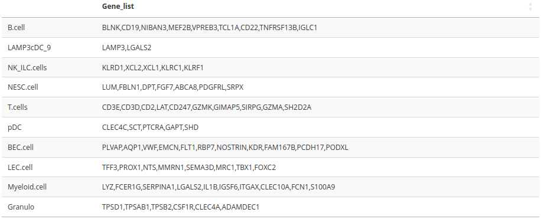

# **Cell segmentation**

In **Xenium output files**, a segmentation generated by the **built-in Xenium segmentation tool** is already provided for the dataset. However, this segmentation is image-based and relies on nuclear, cytoplasmic and membrane staining. It does not account for important limitations, such as **transcript diffusion outside of cells** during the tissue processing or the **three-dimensional nature of the tissue**, where overlapping cells can lead to inaccurate segmentation. Failing to account for these limitations leads to less accurate cell segmentation and can compromise all subsequent steps in the workflow, including cell type annotation, neighborhood analysis, and cell–cell communication.

The aim of this analysis step is therefore to refine the Xenium-provided segmentation using [**Proseg**](https://github.com/dcjones/proseg) (probabilistic segmentation). This tool is designed to address the limitations described above and improve upon the initial cell segmentation by producing a more accurate result.

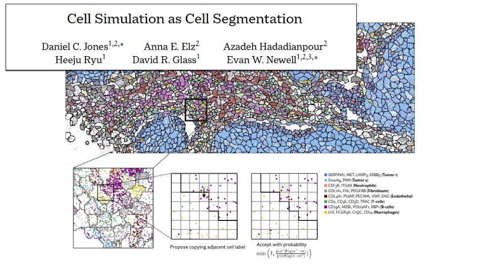

This analysis step, based on Proseg v3, is more broadly implemented within **PASTIS**, a Snakemake pipeline. PASTIS streamlines the workflow by taking Xenium output as input, running Proseg to refine the segmentation, and then converting the results back into a standard Xenium format. These outputs can subsequently be loaded into a Seurat object using the Read10X functions.

The PASTIS pipeline also supports **grid search for hyperparameter optimization**. Specifically, for three Proseg parameters (“diffusion_probability”, “voxel_layers”, and “nuc_assignment”), a range of values can be defined (see expert_config.yaml). The Snakemake pipeline then automatically processes the selected sample(s) using all possible combinations of these parameters. Running the analysis with multiple parameter sets makes it possible to identify the configuration that yields the highest-quality cell segmentation (see "Proseg Hyperparameter Search" analysis step).

# **Proseg hyperparameter search**

The aim of this analysis step is to identify the set of **Proseg parameters**, processed in the "Cell segmentation" step, that yields the highest-quality cell segmentation regarding following metrics:

  - Number of cells in the data (**nb_cells**): Since Proseg works by refining existing cells rather than generating new ones, this value should remain close to the number of cells in the initial Xenium segmentation.
  - Number of conserved cells (**nb_conserved**): Conserved cells are those that pass quality control (QC) criteria based on pre-defined feature counts and cell size thresholds. Because Proseg performs additional filtering on the transcripts, it typically reduces the number of conserved cells obtained during QC. Ideally, the selected hyperparameters should preserve a conserved cell count as close as possible to that of the initial Xenium segmentation. Since only conserved cells are retained for downstream analyses, excessive cell loss may create artificial gaps in the tissue and negatively impact subsequent steps, such as neighborhood analysis.
  - Number of low feature cells (**nb_low_feature**): Low feature cells are cells that fail the feature count filter but pass the cell size filter. Proseg tends to increase the number of low feature cells during segmentation refinement, and the selected hyperparameters should minimize their occurrence.
  - Number of high area cells (**nb_high_area**): High area cells are cells that pass the feature count filter but fail the cell size filter.
  - Number of low feature and high area cells (**nb_low_features_high_area**): Cells that fail both quality thresholds.
  - Mean mutually exclusive co-expression rate (**mean_MECR**): The mutually exclusive co-expression rate is computed per gene pair, and the mean value is then calculated across the dataset. MECR is defined as the fraction of cells expressing both markers divided by the fraction of cells expressing at least one of the markers.
  - Median mutually exclusive co-expression rate (**median_MECR**): The median value of the mutually exclusive co-expression rate across all gene pairs, computed in the same way as above.

For example, the following figure displays the metrics described above plotted against one another, with each dot representing a single Proseg run and colored according to its voxel layer parameter value:

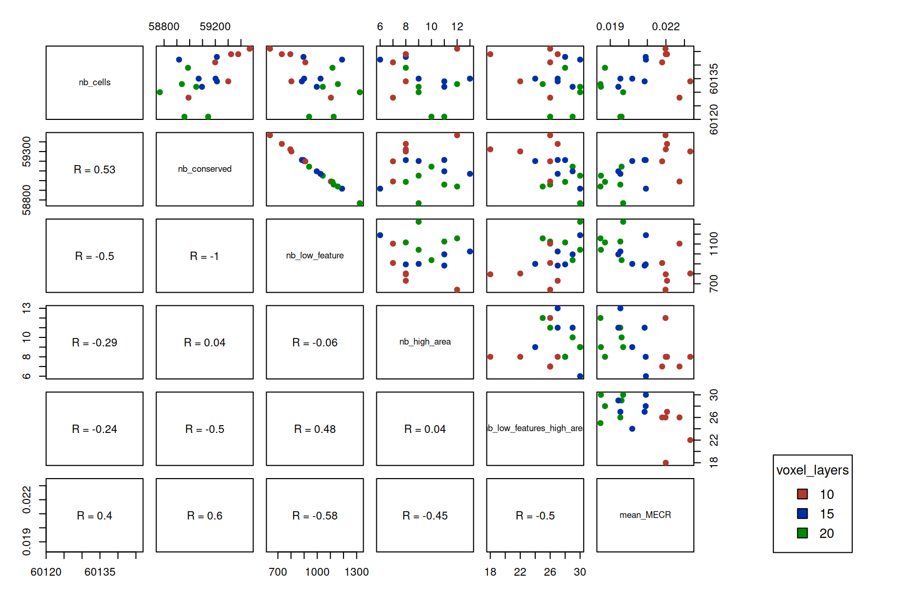

The **selected hyperparameter set** is defined as the one that produces a segmentation with:

  - Low MECR values
  - Few low-feature cells
  - A number of conserved cells similar to that of the initial Xenium segmentation

In these Proseg runs, it is commonly observed that as MECR decreases, the number of low-feature cells increases. This trade-off makes Proseg parameter selection challenging. The objective is therefore to identify a parameter set that achieves sufficiently low MECR while maintaining a low number of low-feature cells (or, equivalently, preserving a relatively high number of conserved cells).

# **Segmentation summary**

The aim of this analysis step is to provide a **global overview of the Proseg segmentation** using the optimal set of hyperparameters selected in the previous step. No specific downstream analysis is performed at this stage; instead, the goal is to visualize the improvement in segmentation quality and obtain a first view of the cell clusters present in the spatial data.

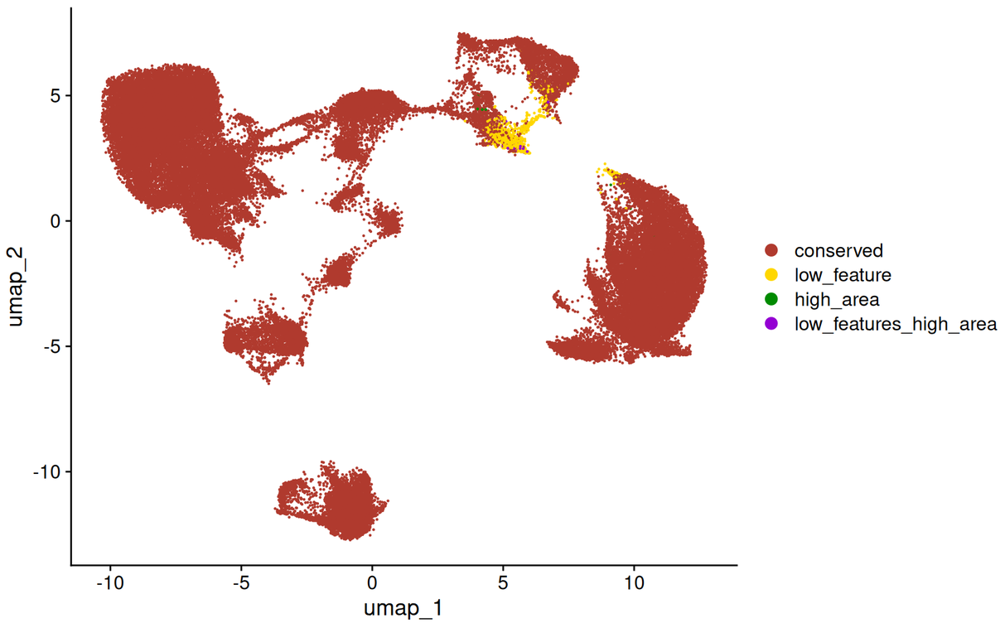

# **TMA processing**

When generating the output data, Xenium supports the selection of a maximum of **eight regions of interest (ROIs)** for a single slide, which may not be sufficient to cover all samples within a TMA. As a result, **multiple samples** may be included in a single Xenium output directory.

For simplicity, in this workflow, Proseg segmentation was directly applied to the combined Xenium outputs containing multiple samples. However, **sample-specific segmentation is recommended** to account for potential differences between samples.

This step aims to **split the tissue microarray into individual samples** after Proseg segmentation. Currently, the Seurat objects do not contain metadata linking each cell to its corresponding sample on the TMA:

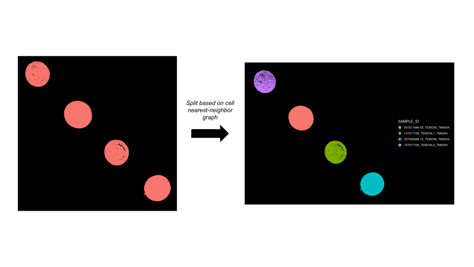

The goal is therefore to identify the spatial location of each sample on the TMA and assign cells accordingly.

Sample detection is performed using a **nearest-neighbor graph**. Cells are first connected to their spatial nearest neighbors, and the resulting connected components are then classified as either individual samples or background based on their size (i.e., number of cells per component). See the **"split_xenium_tma_samples" function** for more details.

Once the samples have been identified within each TMA, their **overall quality** can be assessed. Similarly to identifying **low-quality cells** that need to be filtered out in later steps, **low-quality samples** can also be identified and completely excluded from the analysis.

For example, if most cells within a sample are classified as low quality, the entire sample is removed from the analysis. This prevents biased downstream neighborhood analyses that could result from retaining samples with too few high-quality cells and excessive gaps in the tissue.

The following **metrics** are used to assess **sample quality**:

  - **Total area**: Total cell-covered area of the sample. This metric tends to be low when the tissue is insufficiently dense or when only a small portion of the tissue remains on the TMA.
  - **Conserved cell percentage**: Percentage of cells in the sample that were not flagged as low quality during cell-level QC.
  - **Transcript density**: Transcript density within the sample. This metric can be used to assess whether the gene panel used in the experiment was appropriate for the samples.

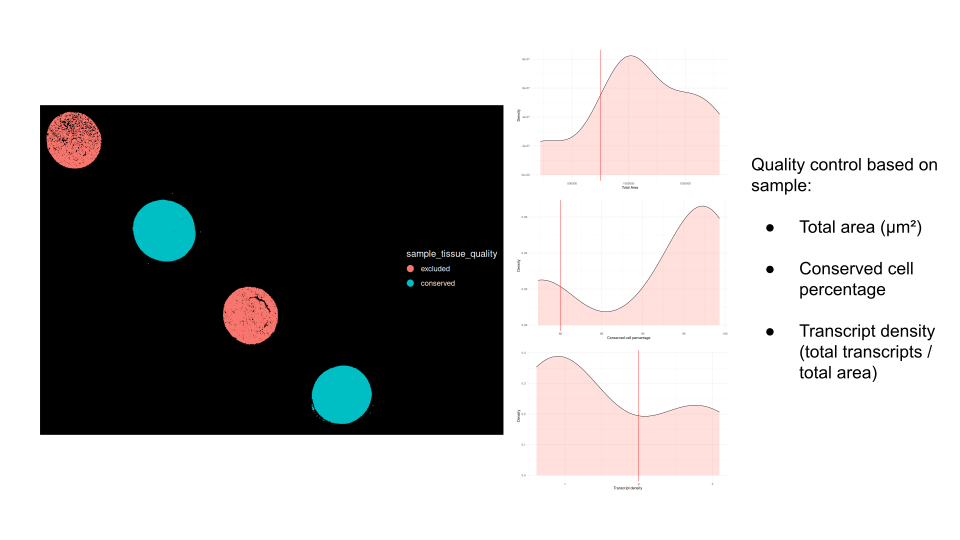

# **Merge TMAs**

The aim of this analysis step is to merge the Seurat objects generated in the "TMA processing" step where cells have been assigned to their corresponding samples and annotated with quality control metrics into a single Seurat object.

Once merged, both samples and cells are filtered based on the previously defined quality control criteria.

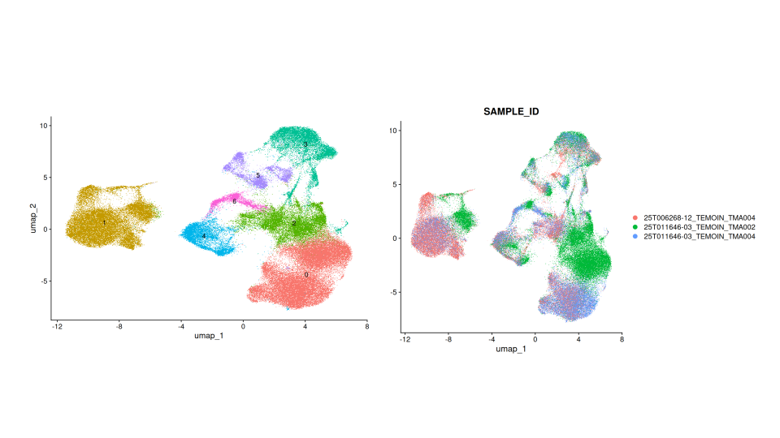

# **Integrate TMAs**

The aim of this analysis step is to **integrate** the data within the merged Seurat object to remove any **batch effects** that may be observed. In this case, in "Merge TMAs" section, a **batch effect related to the TMA** was identified when clustering cells from the merged dataset.

Therefore, [**Harmony**](https://github.com/immunogenomics/harmony) will be used for the integration. The batch-corrected low-dimensional embedding obtained from Harmony will help reduce batch effects between the TMAs and enable better characterization of cell types during manual annotation in downstream analyses.

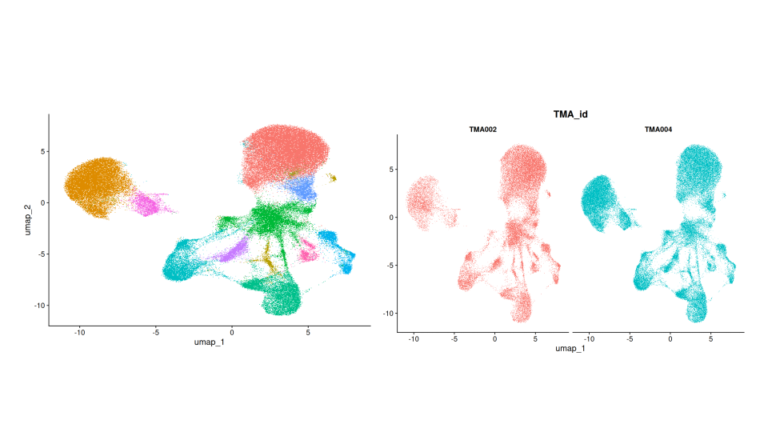

# **Manual cell annotation**

The aim of this analysis step is to **manually annotate** the cell clusters obtained from the Harmony-integrated dataset by assigning them to their corresponding cell types. This annotation process is iterative.

First, cells are clustered and annotated into **broad cell types (Level 1)**. Once these major populations are identified, each can be subsetted and re-clustered to reveal **finer heterogeneity**. Based on this refined clustering, more specific cell types (**Level 2**) can be annotated. Note that for the re-clustering step, a new Harmony integration must be performed on this subset of cells prior to clustering.

An important aspect of this process is the choice of clustering resolution. The selected resolution strongly influences the granularity and biological interpretability of the resulting clusters. The **optimal resolution** is therefore chosen based on the one that yields the most **biologically meaningful clusters**, as assessed by marker gene expression patterns and their coherence with known cell type signatures.

This process can be repeated iteratively to define increasingly granular levels of annotation (e.g., Level 3 and beyond), until no additional biologically meaningful subpopulations can be identified.

Manual annotation is guided by the marker genes identified for each cluster using the **FindAllMarkers** function from Seurat. In this case, because a reference annotated single-cell dataset is available, correspondence between marker genes from the spatial dataset and clusters in the single-cell reference can be used to facilitate and refine the annotation process. This comparison helps to identify matching cell types and improves annotation accuracy.

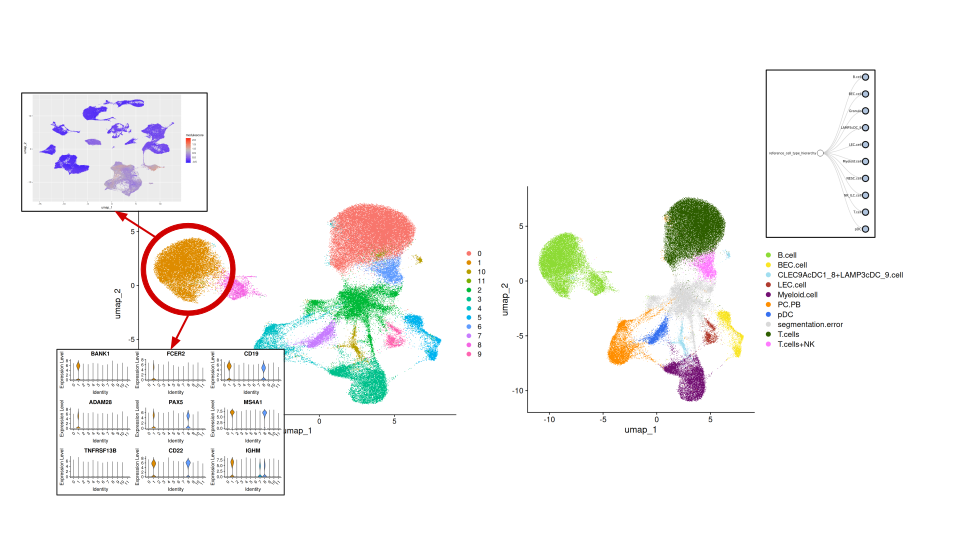

Note that some cells can be annotated as **segmentation errors** because they exhibited marker genes from **multiple distinct cell types**, suggesting potential issues such as **poor segmentation**.

# **Automatic cell annotation**

The aim of this analysis step is to **automatically annotate** cell clusters and individual cells obtained from the Harmony-integrated dataset using two distinct methods: [**scType**](https://github.com/IanevskiAleksandr/sc-type) and [**SingleR**](https://github.com/dviraran/singler), which rely on different principles.

**scType** performs annotation at the **cluster level** by evaluating the enrichment of known marker genes from curated cell type–specific gene sets. In contrast, **SingleR** operates at the **single-cell level** and assigns labels by comparing each cell’s expression profile to **annotated reference** cells from a single-cell dataset using correlation-based approaches.

These two methods are applied independently to provide alternative automatic annotations based on different underlying assumptions.

# **Neighborhood analysis**

The aim of this analysis step is to characterize **cell neighborhoods** in each sample of the merged TMA dataset. In spatial transcriptomics, neighborhood analysis consists of clustering cells by jointly leveraging their **molecular profiles** and **spatial context**. In this framework, neighborhoods are defined as groups of cells sharing a similar local microenvironment.

Specifically, this is achieved using [**BANKSY**](https://github.com/prabhakarlab/Banksy), which constructs a **neighbor-augmented expression matrix** by integrating each cell’s own transcriptome with the transcriptomic information of its spatial neighbors. Standard clustering methods are then applied to this augmented representation, similarly to single-cell RNA-seq analysis. However, in this context, the resulting **clusters** do not represent cell types, but instead correspond to **spatially defined cellular neighborhoods**.

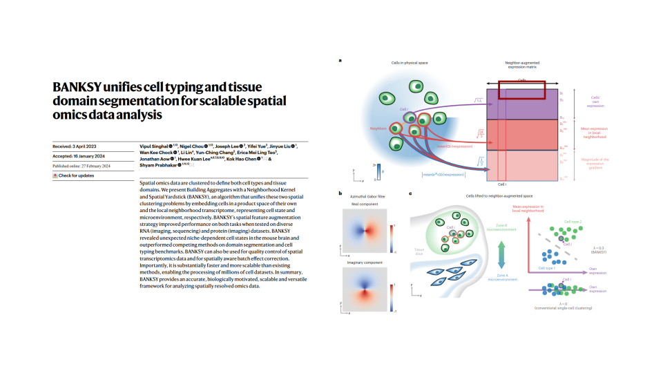

Once these neighborhoods are defined, their **cellular composition** can be characterized in terms of cell types, and correspondence between **similar neighborhood structures** across different samples can be assessed. This similarity analysis allows to obtain a unified neighborhood annotation across samples.

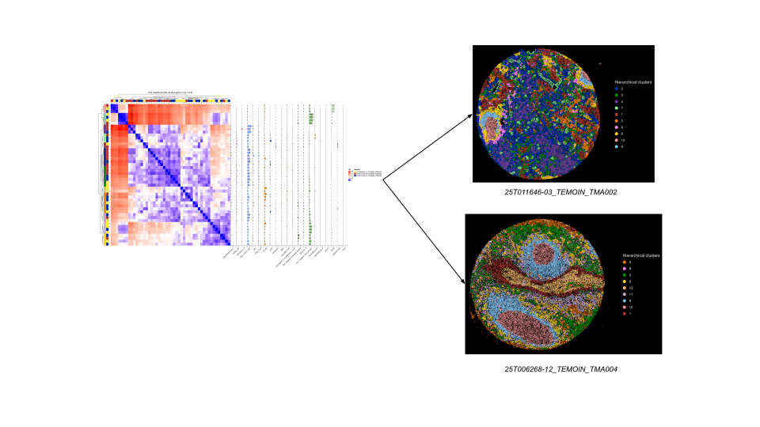
